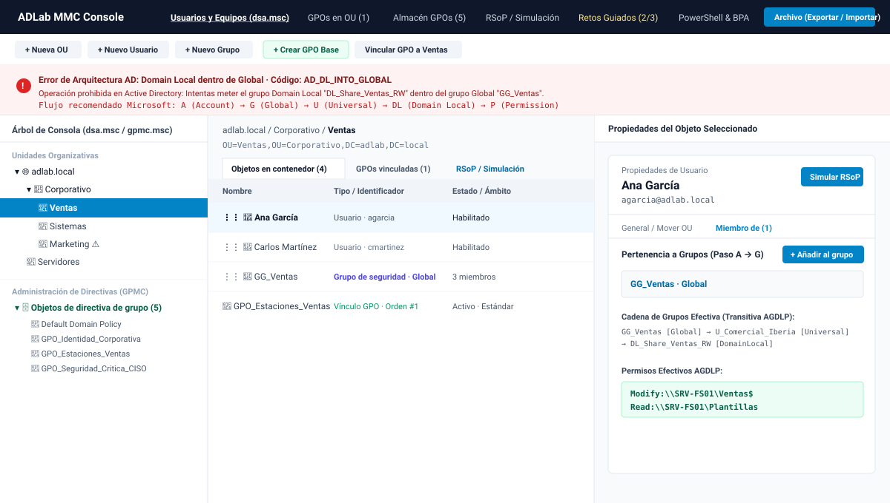
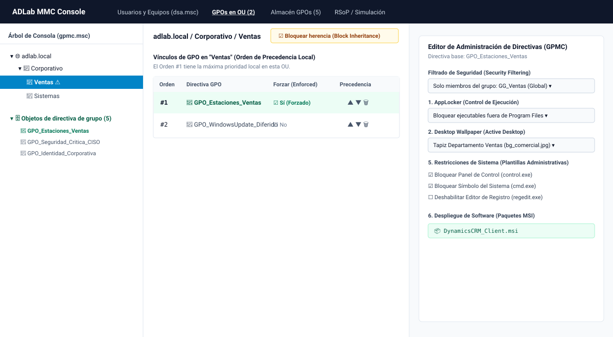
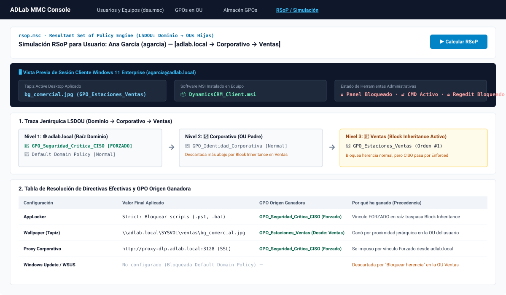
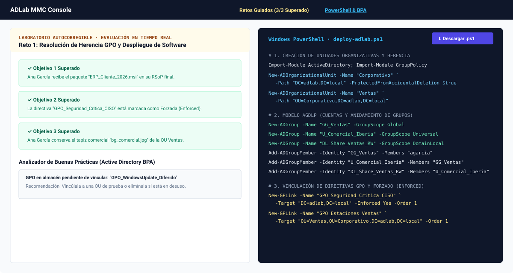

# 🛡️ ADLab — Simulador Educativo de Active Directory, AGDLP y Directivas de Grupo (GPO / RSoP)

<p align="left">
  <a href="https://www.unfantasmaenelsistema.com/" target="_blank" rel="noopener noreferrer">
    
  </a>
</p>

**Un proyecto de [Un Fantasma en el Sistema — https://www.unfantasmaenelsistema.com/](https://www.unfantasmaenelsistema.com/)**


**ADLab** es un laboratorio interactivo de administración de sistemas Windows Server que se ejecuta **100% en el navegador** (sin servidores backend ni máquinas virtuales pesadas). Permite a estudiantes y docentes de **Administración de Sistemas Informáticos en Red (ASIR)**, **Ingeniería Informática** y certificaciones **Microsoft (AZ-800 / MD-102)** practicar en tiempo real:

1. **Jerarquía de Unidades Organizativas (`dsa.msc`)** y generación automática de *Distinguished Names* (`DN`).
2. **Modelo de Anidamiento de Grupos AGDLP / AUGDLP** (`Account → Global → Universal → Domain Local → Permission`) con validación pedagógica en vivo y soporte *Drag & Drop*.
3. **Consola de Administración de Directivas de Grupo (`gpmc.msc`)** con almacén central de GPOs, *Orden de Precedencia Local (`Link Order #1, #2`)*, *Bloqueo de Herencia (`Block Inheritance`)*, *Vínculos Forzados (`Enforced / No Override`)* y *Filtrado de Seguridad (`Security Filtering`)*.
4. **Motor de Conjunto Resultante de Directivas (`rsop.msc` / RSoP)** que evalúa la herencia **LSDOU** paso a paso, justifica por qué gana cada directiva y simula el escritorio resultante de **Windows 11 Enterprise** del usuario.
5. **Generador en Vivo de Scripts Windows PowerShell (`deploy-adlab.ps1`)** y **Analizador de Buenas Prácticas (BPA)**.
6. **Retos Guiados Autocorregibles y Exportación/Importación de Escenarios (`.json`)** para exámenes y prácticas en el aula.

---

## 📸 Capturas de Pantalla de la Consola

### 1. Consola de Usuarios y Equipos (`dsa.msc`) y Validación Educativa AGDLP
Incluye árbol jerárquico de OUs, arrastrar y soltar (*Drag & Drop*) de usuarios/grupos y alertas pedagógicas cuando el alumno intenta vulnerar la arquitectura de ámbitos de Active Directory (por ejemplo, anidar un grupo `Domain Local` dentro de un grupo `Global`).



---

### 2. Administración de Directivas de Grupo (`gpmc.msc`) y Orden de Precedencia
Repositorio central *"Objetos de directiva de grupo"*, vinculación a OUs, reordenación de prioridad (`#1`, `#2`), activación de **Forzar (`Enforced`)**, **Bloquear Herencia (`Block Inheritance`)**, **Filtrado de Seguridad** y despliegue de paquetes `.msi`.



---

### 3. Motor de Simulación RSoP (`rsop.msc`) y Vista Previa de Cliente Windows 11
Calcula qué directivas se aplican finalmente a cualquier usuario del dominio siguiendo estrictamente el orden **Dominio → OU Padre → OU Hija**, mostrando la GPO ganadora, las directivas descartadas y el estado final de la estación de trabajo.



---

### 4. Retos Guiados Autocorregibles y Generador de Scripts PowerShell (`.ps1`)
Los alumnos pueden resolver escenarios con fallos reales verificados en tiempo real y exportar toda su infraestructura como un script oficial de **Windows PowerShell (`ActiveDirectory` & `GroupPolicy`)** listo para ejecutarse en un controlador de dominio real.



---

## 🧠 Reglas de Arquitectura Simuladas con Precisión

### 1. Reglas de Anidamiento AGDLP / AUGDLP
El motor valida tanto las **reglas técnicas duras de Active Directory** como las **buenas prácticas de diseño de Microsoft**:

| Origen \ Destino | Grupo Global (`G`) | Grupo Universal (`U`) | Grupo Domain Local (`DL`) |
| :--- | :---: | :---: | :---: |
| **Usuario (`Account - A`)** | ✅ **Recomendado (A → G)** | ⚠️ *Advertencia AGDLP (replicación GC)* | ⚠️ *Advertencia AGDLP (asignación directa)* |
| **Grupo Global (`G`)** | ✅ Permitido (mismo dominio) | ✅ **Recomendado (G → U)** | ✅ **Recomendado (G → DL)** |
| **Grupo Universal (`U`)** | ❌ **Prohibido por AD** | ✅ Permitido | ✅ **Recomendado (U → DL)** |
| **Grupo Domain Local (`DL`)** | ❌ **Prohibido por AD** | ❌ **Prohibido por AD** | ⚠️ *Permitido en AD / Desaconsejado en AGDLP* |

> 💡 **Detección de Ciclos Kerberos/LSA**: El motor incluye un algoritmo de búsqueda en grafos (`DFS`) que impide referencias circulares entre grupos (ej. `Grupo A → Grupo B → Grupo A`).

---

### 2. Algoritmo de Resolución de Directivas de Grupo (RSoP / LSDOU)
Cuando se pulsa **"Calcular RSoP"** sobre un usuario, `ADEnvironment.calculateUserRSoP(userId)` ejecuta el flujo exacto de Windows Server:

1. **Herencia Descendente (`Dominio → OU Padre → OU Hija`)**: Las directivas se procesan desde la raíz `adlab.local` bajando por cada sub-OU hasta la OU donde reside el usuario. En caso de conflicto entre GPOs normales, **gana la más cercana al usuario**.
2. **Precedencia de Orden de Vínculo (`Link Order`)**: Si una misma OU tiene múltiples GPOs vinculadas, se evalúan de mayor a menor número (`#3 → #2 → #1`), de modo que el **Orden `#1`** sobrescribe al resto dentro de esa OU.
3. **Bloqueo de Herencia (`Block Inheritance`)**: Si una OU intermedia o final tiene activado `blockInheritance = true`, se vacía la cola de GPOs normales heredadas de niveles superiores.
4. **Vínculos Forzados (`Enforced / No Override`)**: Cualquier vínculo GPO con `enforced = true` es **inmune al Bloqueo de Herencia** y se aplica al final del procesamiento, teniendo máxima prioridad sobre cualquier directiva local de las OUs hijas.
5. **Filtrado de Seguridad (`Security Filtering`)**: Si una GPO restringe su ámbito a un grupo de seguridad concreto (ej. `GG_Ventas`), el motor comprueba si el usuario pertenece directa o transitivamente a dicho grupo antes de aplicar la directiva.

---

## 🎓 Flujo de Trabajo para Profesores y Alumnos

### Exportar e Importar Escenarios (`adlab-snapshot.json`)
1. El **profesor** diseña un escenario en la consola (o modifica uno existente introduciendo un fallo de herencia, un filtrado de seguridad incorrecto o una cadena AGDLP incompleta).
2. Desde el menú superior **Archivo → Exportar Laboratorio**, descarga el archivo `adlab-snapshot.json` y lo comparte con sus alumnos (Moodle, Classroom o GitHub).
3. El **alumno** abre ADLab en su navegador, pulsa **Archivo → Importar Laboratorio**, selecciona el archivo `.json`, diagnostica el problema con la herramienta **RSoP**, lo corrige y exporta su solución entregable.

### Retos Guiados Incluidos de Serie
En la pestaña **"Retos Guiados"**, la aplicación incluye **3 laboratorios autocorregibles**:
- **Reto 1 (Herencia GPO y Despliegue MSI)**: Diagnosticar por qué `Ana García` (`OU=Ventas`) no recibe el paquete `ERP_Cliente_2026.msi` debido a un bloqueo de herencia y forzar la directiva crítica del CISO desde la raíz del dominio.
- **Reto 2 (Arquitectura Completa AGDLP)**: Construir la cadena `Carlos Martínez (A) → Grupo Global (G) → Grupo Universal (U) → Grupo Domain Local (DL) → Modify:\\SRV-FS01\Auditorias$ (P)` sin romper las reglas de ámbito.
- **Reto 3 (Precedencia de Vínculo y Endurecimiento)**: Configurar el orden de vínculo `#1` para el anillo diferido de Windows Update en la OU `Sistemas` y bloquear `cmd.exe` y `regedit.exe` para `Elena Rodríguez`.

---

## 🚀 Instalación Local y Despliegue en GitHub Pages

### Ejecución en Entorno Local

```bash
# 1. Clonar el repositorio
git clone https://github.com/tu-usuario/adlab-simulator.git
cd adlab-simulator

# 2. Instalar dependencias
npm install

# 3. Iniciar servidor de desarrollo (puerto 3000)
npm run dev
```

### Compilación Estática y Despliegue en GitHub Pages

El proyecto incluye un flujo de trabajo de **GitHub Actions** preconfigurado en [`.github/workflows/deploy.yml`](./.github/workflows/deploy.yml):

1. Sube el código a tu repositorio de GitHub en la rama `main`.
2. Ve a **Settings → Pages** en tu repositorio de GitHub.
3. En **Build and deployment → Source**, selecciona **GitHub Actions**.
4. Cada `git push` compilará automáticamente el proyecto con rutas relativas (`vite build --base="./"`) y publicará el simulador en `https://tu-usuario.github.io/adlab-simulator/`.

---

## 📂 Estructura del Proyecto

```text
├── .github/
│   └── workflows/
│       └── deploy.yml                  # CI/CD automático para GitHub Pages
├── docs/
│   └── screenshots/                    # Capturas vectoriales de alta resolución para documentación
│       ├── 01-dsa-msc-agdlp.svg
│       ├── 02-gpmc-gpo-links.svg
│       ├── 03-rsop-simulation.svg
│       └── 04-powershell-challenges.svg
├── src/
│   ├── adModel.js                      # Motor Vanilla JS (ES6): ADEnvironment, OU, User, Group, GPO, GPOLink, RSoP y PowerShell
│   ├── App.tsx                         # Interfaz de consolas MMC (dsa.msc, gpmc.msc, rsop.msc, Retos y BPA)
│   ├── index.css                       # Estilos base Tailwind CSS v4 y tipografía técnica
│   └── main.tsx                        # Punto de entrada de la aplicación
├── index.html
├── package.json
└── README.md
```

---

## 💻 Uso Programático desde la Consola del Navegador (DevTools)

Para fines didácticos avanzados, la instancia activa del laboratorio está expuesta globalmente en `window.adLab`:

```javascript
// Inspeccionar el estado completo en JSON
console.log(window.adLab.toJSON());

// Calcular el RSoP de cualquier usuario por ID
const ana = Object.values(window.adLab.users).find(u => u.samAccountName === 'agarcia');
console.table(window.adLab.calculateUserRSoP(ana.id).settingsTable);

// Generar por consola el script de despliegue en PowerShell
console.log(window.adLab.generatePowerShellDeploymentScript());
```

---

## 📄 Licencia

Distribuido bajo la licencia **Apache 2.0**. Libre para uso educativo en institutos, universidades y laboratorios de formación técnica.
